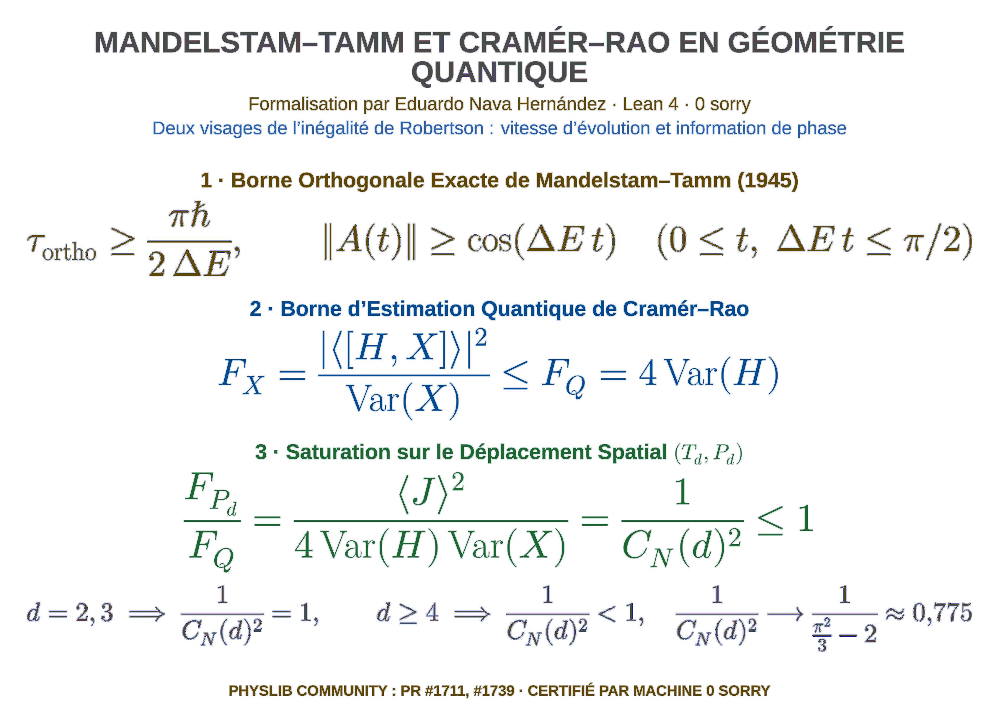
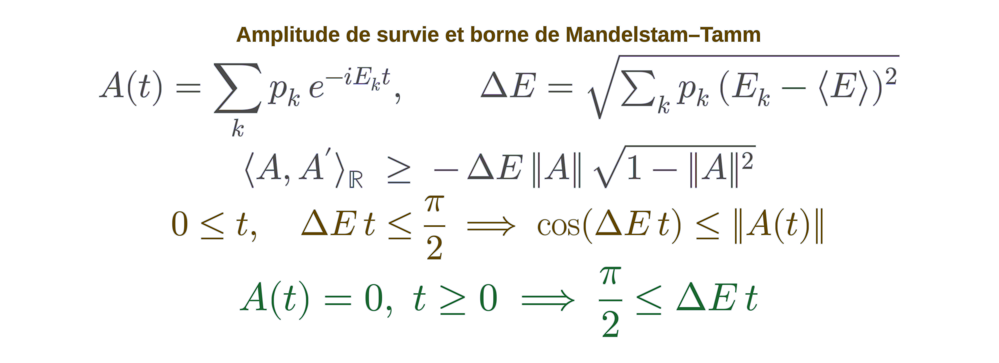
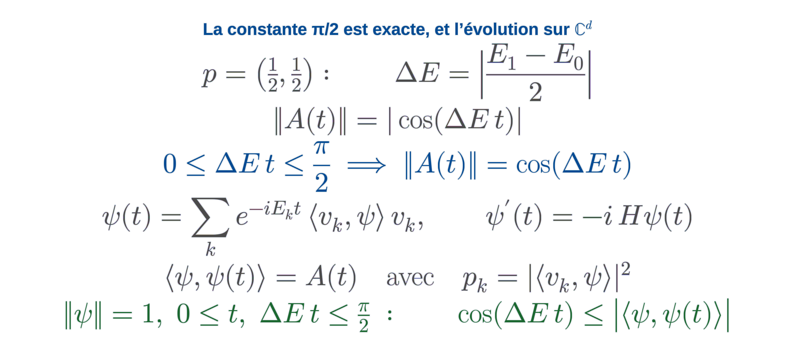
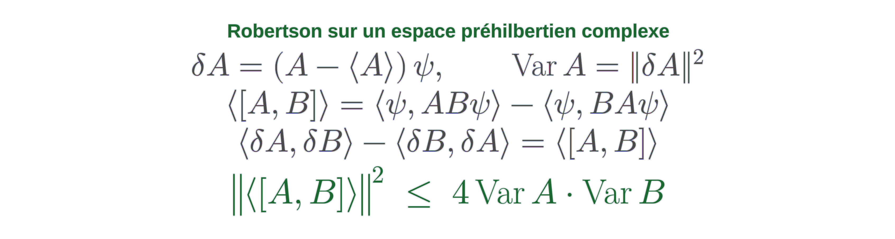
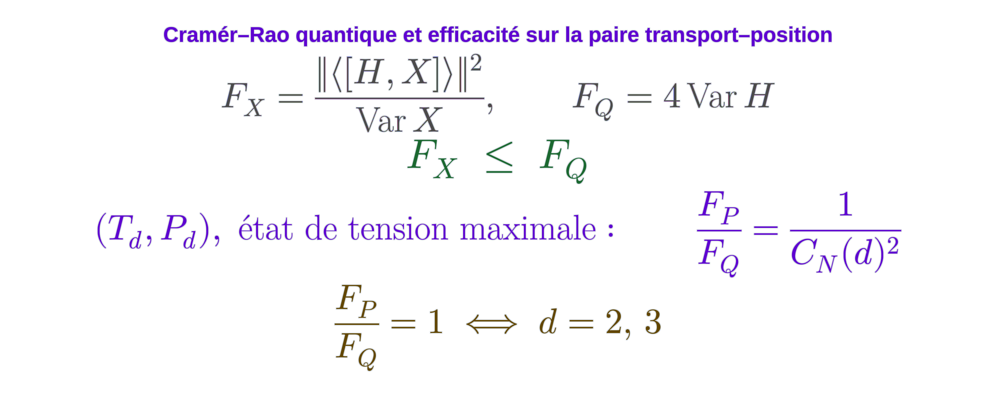

<div align="center">

# RS^N³ · Mandelstam–Tamm et Cramér–Rao
### Deux visages de l'incertitude quantique : vitesse d'évolution et borne d'estimation de phase

**Eduardo Nava Hernández**  
*Vérification formelle certifiée en Lean 4 · 0 sorry · Physlib (PhyslibAlpha)*

[](https://leanprover.github.io/)
[](https://github.com/leanprover-community/mathlib4)
[](Verification/Axioms.lean)
[](https://github.com/leanprover-community/physlib/pulls?q=is%3Apr+is%3Amerged+author%3Anaype888-cloud)
[](https://naype888-cloud.github.io/nrs3-mandelstam-tamm-cramer-rao/)
[](https://naype888-cloud.github.io/nrs3-mandelstam-tamm-cramer-rao/cramer-rao.html)

</div>

---

> ### 🏛️ Deux visages d'une même inégalité géométrique
>
> Deux conséquences fondamentales de l'inégalité de Robertson gouvernent l'évolution temporelle et la métrologie quantique :
>
> <div align="center">
> <picture><source media="(prefers-color-scheme: dark)" srcset="assets/oscuro/plaque_mt_cr_protagoniste.png"></picture>
> </div>
>
> **1 · Borne de vitesse de Mandelstam–Tamm (1945).** Aucun état quantique ne peut devenir orthogonal à son état initial avant le temps caractéristique τ_ortho ≥ πħ / (2ΔE), la constante π/2 étant géométriquement exacte et optimale.
>
> **2 · Borne d'estimation de phase de Cramér–Rao.** Aucune mesure de position ou d'observable X ne peut extraire plus d'information sur un paramètre de translation que l'information quantique de Fisher F_Q = 4 Var(H).
>
> **3 · La paire canonique transport-position (T_d, P_d).** Sur le déplacement spatial élémentaire, le paramètre est encodé par le transport T_d et lu par la position P_d. À tension maximale, le ratio d'efficacité est exactement égal à 1 / C_N(d)².
>
> **4 · Saturation en d ≤ 3 et limite de Szegő.** L'efficacité d'estimation atteint 100% si et seulement si d ≤ 3 (C_N = 1). Dès d ≥ 4, l'efficacité décroît strictement vers la borne asymptotique de Szegő 1 / (π²/3 − 2) ≈ 0.775.

---

## 🌐 Cadre géométrique : le transport spatial comme générateur élémentaire

Dans tout espace normé euclidien, la séparation entre deux états est une distance métrique unidimensionnelle. Pour relier ces états, la dynamique exige nécessairement un opérateur de translation le long de cet axe de séparation.

La paire canonique (T_d, P_d) ne constitue pas une abstraction combinatoire de graphe : elle est **la définition géométrique élémentaire de la translation et de la position spatiales**, échantillonnée à résolution finie d sur le segment [−1, 1].

Lorsque l'on étudie la vitesse de déplacement ou la précision d'estimation d'un paramètre spatial :
* Mandelstam–Tamm borne la vitesse maximale à laquelle un état peut évoluer vers l'orthogonalité par sa dispersion de transport ΔE.
* Cramér–Rao borne la sensibilité avec laquelle l'observable de position P_d résout la translation générée par T_d.
* L'efficacité relative F_P / F_Q coïncide identiquement avec l'inverse du carré de la constante d'incertitude dimensionnelle : 1 / C_N(d)².

---

## ⚡ Résumé formel

Ce dépôt formalise les deux théorèmes fondamentaux de la dynamique et de la métrologie quantiques sur espaces de Hilbert généraux et sur ℂ^d :

* L'amplitude de survie A(t) et le temps minimal d'orthogonalité sont établis dans [`NRS3MandelstamTammCramerRao/MandelstamTamm1945.lean`](NRS3MandelstamTammCramerRao/MandelstamTamm1945.lean) (`cos_le_norm_amplitude`, `orthogonality_time`).
* Le cas d'égalité stricte pour deux branches d'énergie égale et la dynamique finie de Schrödinger sont certifiés dans [`NRS3MandelstamTammCramerRao/MandelstamTamm1945.lean`](NRS3MandelstamTammCramerRao/MandelstamTamm1945.lean) (`norm_amplitude_half_eq_cos`, `cos_le_norm_inner_evolve`).
* L'identité de Robertson pour commutateurs et covariances est démontrée dans [`NRS3MandelstamTammCramerRao/CramerRao.lean`](NRS3MandelstamTammCramerRao/CramerRao.lean) (`robertson`, `inner_dev_sub`).
* La borne quantique de Cramér–Rao pour toute observable symétrique est formalisée dans [`NRS3MandelstamTammCramerRao/CramerRao.lean`](NRS3MandelstamTammCramerRao/CramerRao.lean) (`fisher_le_qfi`).

---

## 📐 Démonstration constructive en quatre étapes

### Étape 1 : Amplitude de survie et borne géométrique de Mandelstam–Tamm

> **Proposition 1.1 (Borne de l'amplitude de survie).** Pour tout état quantique de dispersion d'énergie ΔE sur un spectre fini, la norme de l'amplitude de survie A(t) satisfait ‖A(t)‖ ≥ cos(ΔE t) tant que ΔE t ≤ π/2.

<div align="center"><picture><source media="(prefers-color-scheme: dark)" srcset="assets/oscuro/plaque_mt_etape1.png"></picture></div>

*Module formel (amplitude) :* [`NRS3MandelstamTammCramerRao/MandelstamTamm1945.lean`](NRS3MandelstamTammCramerRao/MandelstamTamm1945.lean) (`amplitude`, `spread`, `neg_le_inner_deriv`, `cos_le_norm_amplitude`).  
*Module formel (orthogonalité) :* [`NRS3MandelstamTammCramerRao/MandelstamTamm1945.lean`](NRS3MandelstamTammCramerRao/MandelstamTamm1945.lean) (`orthogonality_time`).

L'amplitude de survie A(t) = ⟨ψ, e^{−iHt/ħ}ψ⟩ représente la somme des phaseurs pondérés p_k e^{−iE_k t}. Son extrémité ne pénètre jamais le disque ouvert de rayon cos(ΔE t). L'orthogonalité A(t) = 0 exige donc impérativement ΔE t ≥ π/2.

---

### Étape 2 : Optimalité de la borne et évolution sur ℂ^d

> **Proposition 2.1 (Caractère exact de la constante π/2).** Un système à deux composantes d'énergies symétriques sature exactement l'inégalité : ‖A(t)‖ = |cos(ΔE t)|.

<div align="center"><picture><source media="(prefers-color-scheme: dark)" srcset="assets/oscuro/plaque_mt_etape2.png"></picture></div>

*Module formel (optimalité) :* [`NRS3MandelstamTammCramerRao/MandelstamTamm1945.lean`](NRS3MandelstamTammCramerRao/MandelstamTamm1945.lean) (`spread_half`, `norm_amplitude_half`, `norm_amplitude_half_eq_cos`).  
*Module formel (dimension finie) :* [`NRS3MandelstamTammCramerRao/MandelstamTamm1945.lean`](NRS3MandelstamTammCramerRao/MandelstamTamm1945.lean) (`hasDerivAt_evolve`, `inner_evolve`, `cos_le_norm_inner_evolve`).

---

### Étape 3 : Inégalité de Robertson et estimation de phase

> **Proposition 3.1 (Formulation hilbertienne de Robertson).** Pour tout couple d'opérateurs symétriques A et B sur un espace préhilbertien complexe, le produit des variances majore le carré de la valeur moyenne du commutateur : ‖⟨[A, B]⟩‖² ≤ 4 Var(A) Var(B).

<div align="center"><picture><source media="(prefers-color-scheme: dark)" srcset="assets/oscuro/plaque_mt_etape3.png"></picture></div>

*Module formel (Robertson) :* [`NRS3MandelstamTammCramerRao/CramerRao.lean`](NRS3MandelstamTammCramerRao/CramerRao.lean) (`expect`, `dev`, `var`, `commExpect`, `inner_dev_sub`, `robertson`).

---

### Étape 4 : Borne d'information de Cramér–Rao et efficacité sur (T_d, P_d)

> **Proposition 4.1 (Information de Fisher et borne quantique).** L'information de Fisher d'estimation de phase F_X = ‖⟨[H, X]⟩‖² / Var(X) ne dépasse jamais l'information quantique de Fisher intrinsèque de l'état F_Q = 4 Var(H).

<div align="center"><picture><source media="(prefers-color-scheme: dark)" srcset="assets/oscuro/plaque_mt_etape4.png"></picture></div>

*Module formel (Cramér-Rao) :* [`NRS3MandelstamTammCramerRao/CramerRao.lean`](NRS3MandelstamTammCramerRao/CramerRao.lean) (`fisher`, `qfi`, `fisher_le_qfi`).  
*Physlib :* PR #1711, PR #1739.

Sur la paire transport-position (T_d, P_d), l'efficacité F_P / F_Q vaut exactement 1 / C_N(d)². Elle atteint 100% à d = 2, 3 (saturation géométrique tridimensionnelle) et décroît dès d ≥ 4 vers la limite asymptotique de Szegő.

---

## 🔬 Tableau des contributions Physlib fusionnées

| PR Physlib | Fichier amont (`PhyslibAlpha/…`) | Énoncé formel principal | Objet physique | Statut |
|:---:|:---|:---|:---:|:---:|
| **#1711** | `TightBindingChain/MandelstamTamm` | Borne de vitesse \|⟨J⟩\| ≤ 2 ΔH ΔX et borne ⟨J⟩²/Var X ≤ 4 Var H | Mandelstam–Tamm & Cramér–Rao | **MERGED** |
| **#1739** | `TightBindingChain/MandelstamTammMaxCurrent` | Réflection exacte du ratio d'efficacité 1/C_N² sur l'état maximal | Saturation d ≤ 3 et limite Szegő | **MERGED** |

---

## 🏛️ Le Mosaïque des développements satellites

Les prolongements thématiques spécialisés sont maintenus dans leurs dépôts respectifs, chacun doté de sa propre suite de preuves Lean 4 :

| Dépôt | Thématique et objet central |
|:---|:---|
| [**RS^N et RS^N³ — théorème de base**](https://github.com/naype888-cloud/nava-robertson-schrodinger) | La structure canonique du cube ouvert et la saturation en dimension d ≤ 3 |
| [**Physlib: PRs fusionnées**](https://github.com/leanprover-community/physlib/pulls?q=is%3Apr+is%3Amerged+author%3Anaype888-cloud) | L'ensemble des résultats de la chaîne et du cube intégrés en amont |
| [`nrs3-hopf`](https://github.com/naype888-cloud/nrs3-hopf) | Fibration de Hopf S³ → S² et géométrie spinorielle |
| [`nrs3-landauer-carnot`](https://github.com/naype888-cloud/nrs3-landauer-carnot) | Coût de dissipation thermodynamique et limite de Carnot |
| [`nrs3-de-sitter`](https://github.com/naype888-cloud/nrs3-de-sitter) | Entropie d'horizon et paramètre de courbure |
| [`nrs3-penrose`](https://github.com/naype888-cloud/nrs3-penrose) | Temps caractéristique de réduction d'état |
| [`nrs3-pauli-dirac`](https://github.com/naype888-cloud/nrs3-pauli-dirac) | Matrices de spin de Pauli et représentations de Clifford |
| [`nrs3-uncertainty-cone`](https://github.com/naype888-cloud/nrs3-uncertainty-cone) | Géométrie de Minkowski induite par la matrice de Gram |
| [`nrs3-poincare`](https://github.com/naype888-cloud/nrs3-poincare) | Quantification discrète selon Poincaré (1912) |
| [`nrs3-defect-curvature`](https://github.com/naype888-cloud/nrs3-defect-curvature) | Quanta de courbure sur surfaces de Riemann fermées |
| [`nrs3-rovelli-lqg`](https://github.com/naype888-cloud/nrs3-rovelli-lqg) | Spectre d'aire et géométrie quantique de boucles |
| [`nrs3-dark`](https://github.com/naype888-cloud/nrs3-dark) | Part non résolue par la lumière et fraction volumétrique |
| [`nrs3-cube`](https://github.com/naype888-cloud/nrs3-cube) | Le cube ouvert multidimensionnel généralisé |

---

## ⏱️ Chronologie historique (1911–1945)

La formalisation résout avec les outils de la théorie des opérateurs une problématique issue de l'ère Solvay :

| Année | Événement historique | Dépôt associé |
|:---:|:---|:---:|
| **1911** | Premier congrès Solvay : radiation et quanta | — |
| **1911–12** | Poincaré : la loi de Planck impose des niveaux discrets | [`nrs3-poincare`](https://github.com/naype888-cloud/nrs3-poincare) |
| **1915–20** | Szegő : théorèmes limites pour matrices de Toeplitz | [Dépôt de base (`D8`)](https://github.com/naype888-cloud/nava-robertson-schrodinger) |
| **1925–27** | Pauli : principe d'exclusion et matrices de spin | [`nrs3-pauli-dirac`](https://github.com/naype888-cloud/nrs3-pauli-dirac) |
| **1927** | Relations d'incertitude de Heisenberg | — |
| **1928** | Dirac : matrices gamma 4 × 4 | [`nrs3-pauli-dirac`](https://github.com/naype888-cloud/nrs3-pauli-dirac) |
| **1929** | van der Waerden : spineurs et représentations de Lorentz | [`nrs3-uncertainty-cone`](https://github.com/naype888-cloud/nrs3-uncertainty-cone) |
| **1929–30** | Robertson et Schrödinger : inégalité avec terme de covariance | [Dépôt de base (`D2`)](https://github.com/naype888-cloud/nava-robertson-schrodinger) |
| **1934** | Robertson : déterminant d'indétermination multi-observables | [Dépôt de base (`D49`)](https://github.com/naype888-cloud/nava-robertson-schrodinger) |
| **1945–46** | Mandelstam et Tamm : borne temps-énergie quantique ; Rao (1945), Cramér (1946) | **[`nrs3-mandelstam-tamm-cramer-rao`](https://github.com/naype888-cloud/nrs3-mandelstam-tamm-cramer-rao)** (ce dépôt) |

---

## 🛠️ Reproduction et vérification formelle en Lean 4

Pour compiler et vérifier l'ensemble des modules formels de ce dépôt :

```bash
# Vérification formelle directe des théorèmes
lake env lean NRS3MandelstamTammCramerRao.lean

# Compilation complète du paquet
lake build

# Vérification des axiomes
lake env lean Verification/Axioms.lean
```

### Base axiomatique standard

Tous les théorèmes compilent strictement sous les axiomes standards de ZFC reconnus par le noyau de Lean 4 et Mathlib :

```text
[propext, Classical.choice, Quot.sound]
```

* **0 `sorry`** dans l'intégralité des modules de Mandelstam–Tamm et Cramér–Rao.
* Aucun axiome additionnel non vérifié.

---

## 📜 Licence

[NRS Noncommercial License 1.0.0](LICENSE) — Libre pour tout usage non commercial, académique et humanitaire, ainsi que pour intégration dans des bibliothèques ouvertes de vérification formelle (Mathlib, Physlib, Lean 4). Voir [LICENSE](LICENSE) pour toute utilisation commerciale.

---

<div align="center">

### 📐 *« Le temps d'orthogonalité est borné par πħ / (2ΔE) et l'information d'estimation par 4 Var(H) : deux faces de la même incertitude géométrique. »*

**Eduardo Nava Hernández** · [naype888-cloud](https://github.com/naype888-cloud)

</div>
